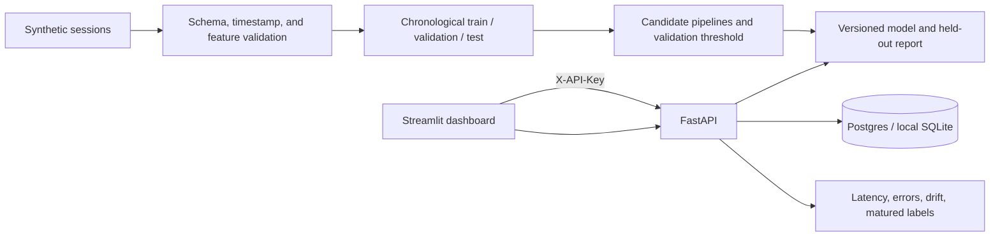

# Architecture

Offline training owns synthetic event generation, label construction, validation, feature engineering, partitioning, candidate comparison, threshold choice, evaluation, and artifact writing. One row is generated per player: the feature window ends at the prediction timestamp, churn is no session in the next fully observed 14 days, and immature outcomes are excluded. Player IDs, future activity, and latent simulator parameters are not features.

The API loads only a trusted configured joblib bundle at process startup. Migrations run before readiness; requests never trigger training or load client-provided artifacts. The API validates and bounds inference, stores only an HMAC pseudonym and five numeric features, tracks model version/source/outcome/latency, and exposes per-player perturbation explanations when supplied. The browser-facing dashboard talks to the API server-side and does not load its own model or database.

Compose and cloud use private-network Postgres; local Python development may use SQLite. Drift compares a recent numeric feature window to stored training-reference bins with PSI. Latency/error counters remain in process memory, while prediction and matured outcome history persists. A drift signal requires human review and never auto-promotes a model. Pseudonymization is not encryption or a guarantee against linkage attacks.

Free Render services are demonstration infrastructure only: free web services can sleep, and free Postgres expires after 30 days and has no backups. Use durable paid resources, access controls, retention policy, and backups before handling real telemetry.
